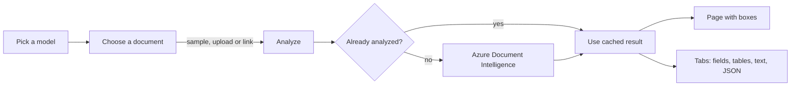
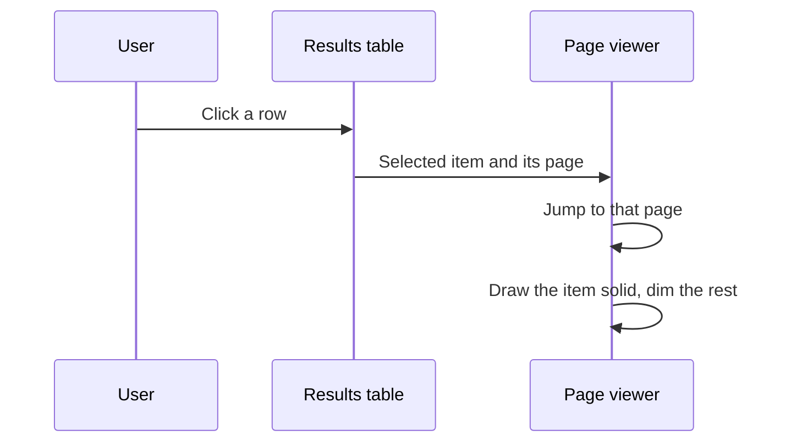
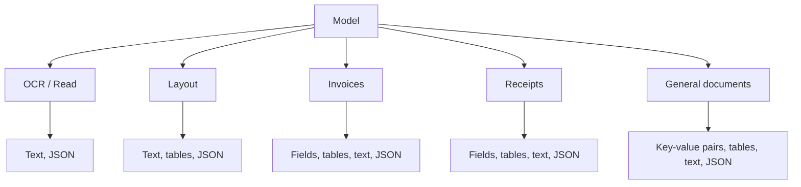

<div align="center">

# Sky-DI

**A mini Document Intelligence Studio, built on Azure AI Document Intelligence.**

Pick a model, give it a document, and see exactly what Azure read.


</div>

---

## Overview

Sky-DI shows the page on the left with a box around every detected item, and tabs on the right for
fields, key-value pairs, tables, text and the raw JSON. Click a row in any table and its box lights up on
the page. It looks like Sky-RAG, and nothing on screen says Streamlit.

### Features

- **Five analysis modes** covering OCR, layout, invoices, receipts and general documents
- **Interactive viewer**: click any result row to jump to its page and highlight its box
- **Three ways in**: bundled samples, file upload (PDF, JPG, PNG, TIFF, BMP up to 20 MB), or a public link
- **Cached results** per file and model, so clicking around never calls Azure twice
- **Custom studio UI** with the Streamlit menu, header, toolbar and footer hidden
- **Container-ready** with a slim, non-root Docker image

### Models

| Dropdown | Azure model |
|---|---|
| OCR / Read | `prebuilt-read` |
| Layout | `prebuilt-layout` |
| Invoices | `prebuilt-invoice` |
| Receipts | `prebuilt-receipt` |
| General documents | `prebuilt-layout` with key-value pairs, since Azure retired `prebuilt-document` in API v4 |

## How it works



Clicking a row redraws the page without calling Azure again:



Each model decides which tabs show up:



## Getting started

### Prerequisites

- An [Azure AI Document Intelligence](https://learn.microsoft.com/azure/ai-services/document-intelligence/) resource (endpoint and key)
- Either **Docker**, or **Python 3.13+**

### Configuration

Copy `.env.example` to `.env` and fill it in:

| Variable | Description |
|---|---|
| `AZURE_DOCINTEL_ENDPOINT` | Your resource endpoint, e.g. `https://<your-resource>.cognitiveservices.azure.com/` |
| `AZURE_DOCINTEL_KEY` | One of the resource's API keys |

### Run with Docker

```bash
docker build -t sky-di .
docker run --rm -p 8501:8501 --env-file .env sky-di
```

Then open <http://localhost:8501>. The container listens on `$PORT` (default `8501`).

### Run locally

```bash
python -m venv .venv
.venv\Scripts\activate        # Windows
source .venv/bin/activate     # macOS / Linux
pip install -r requirements.txt
streamlit run app.py
```

## Deploy

The `Dockerfile` works on any container host: Render, Railway, Fly.io, Azure Container Apps and so on.
Set `AZURE_DOCINTEL_ENDPOINT` and `AZURE_DOCINTEL_KEY` as environment variables. Hosts that inject their
own `PORT` are picked up automatically.

## Project structure

```
sky-di/
├── app.py              # Streamlit entry point
├── skydi/
│   ├── analyzer.py     # Azure call and result-to-table-row helpers
│   ├── render.py       # Page images and bounding-box overlays
│   └── ui.py           # Small HTML builders for the studio look
├── assets/             # CSS (studio, style, motion) and favicon
├── samples/            # Bundled invoice, layout and receipt documents
├── tests/              # Unit tests, no Azure needed
├── .streamlit/         # Streamlit config
└── Dockerfile
```

## Tests

```bash
python -m pytest tests
```

The tests don't need Azure.

## Notes

- Styles live in `assets/`. `studio.css` hides the menu, header, toolbar, footer and deploy button.
- Streamlit serves a blank page with its own title for a split second before the CSS loads. CSS can't
  change that moment.
