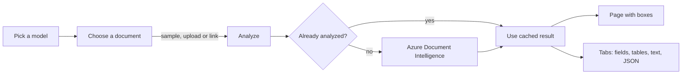
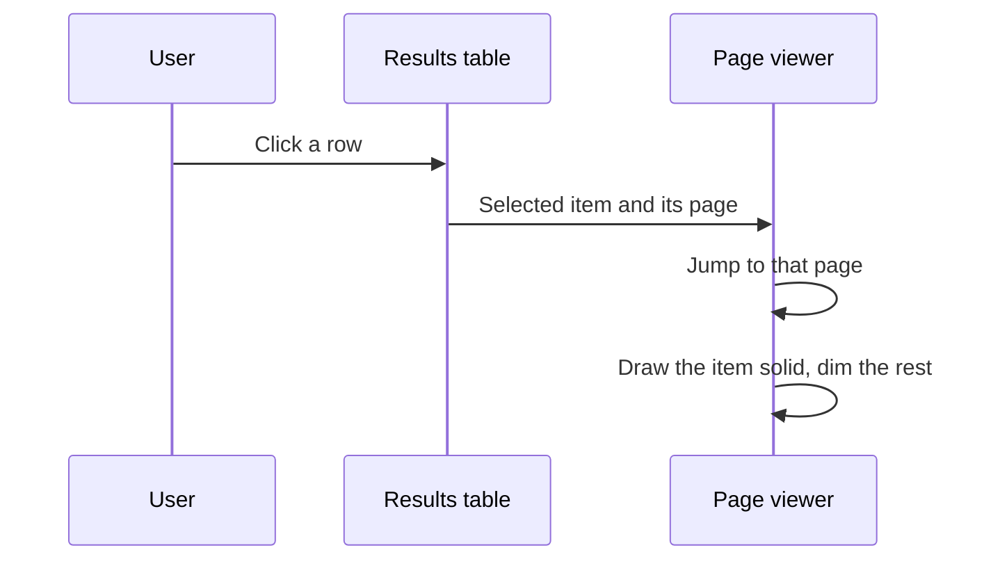
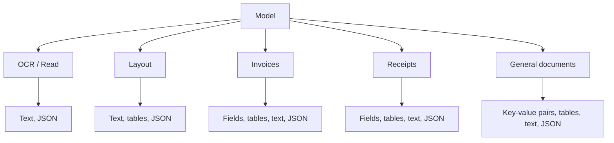

# Sky-DI

A small Document Intelligence Studio. You pick a model, give it a document, and the app shows what Azure
read: the page on the left with a box around every detected item, and tabs on the right for fields,
key-value pairs, tables, text and the raw JSON. It looks like Sky-RAG, and nothing on screen says Streamlit.

| Dropdown | Azure model |
|---|---|
| OCR / Read | `prebuilt-read` |
| Layout | `prebuilt-layout` |
| Invoices | `prebuilt-invoice` |
| Receipts | `prebuilt-receipt` |
| General documents | `prebuilt-layout` with key-value pairs, since Azure retired `prebuilt-document` in API v4 |

## How it works



Clicking a row redraws the page without calling Azure again:



Each model decides which tabs show up:



## Run it

```
python -m venv .venv
.venv\Scripts\activate
pip install -r requirements.txt
copy .env.example .env
streamlit run app.py
```

Put your Document Intelligence endpoint and key in `.env` first.

You can use a bundled sample, upload a file (PDF, JPG, PNG, TIFF or BMP, up to 20 MB), or paste a public
link. Click a row in any table to highlight its box on the page. Results are cached per file and model, so
clicking around doesn't call Azure again.

## Deploy

Like Sky-RAG, the `Procfile` works on Railway or any host that reads one. Set `AZURE_DOCINTEL_ENDPOINT` and
`AZURE_DOCINTEL_KEY` as environment variables.

## Tests

`python -m pytest tests`. They don't need Azure.

## Notes

- Styles are in `assets/`. `studio.css` hides the menu, header, toolbar, footer and deploy button.
- Streamlit serves a blank page with its own title for a split second before the CSS loads. CSS can't
  change that moment.
