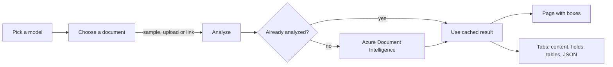
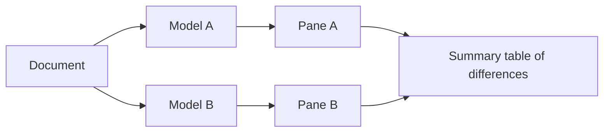
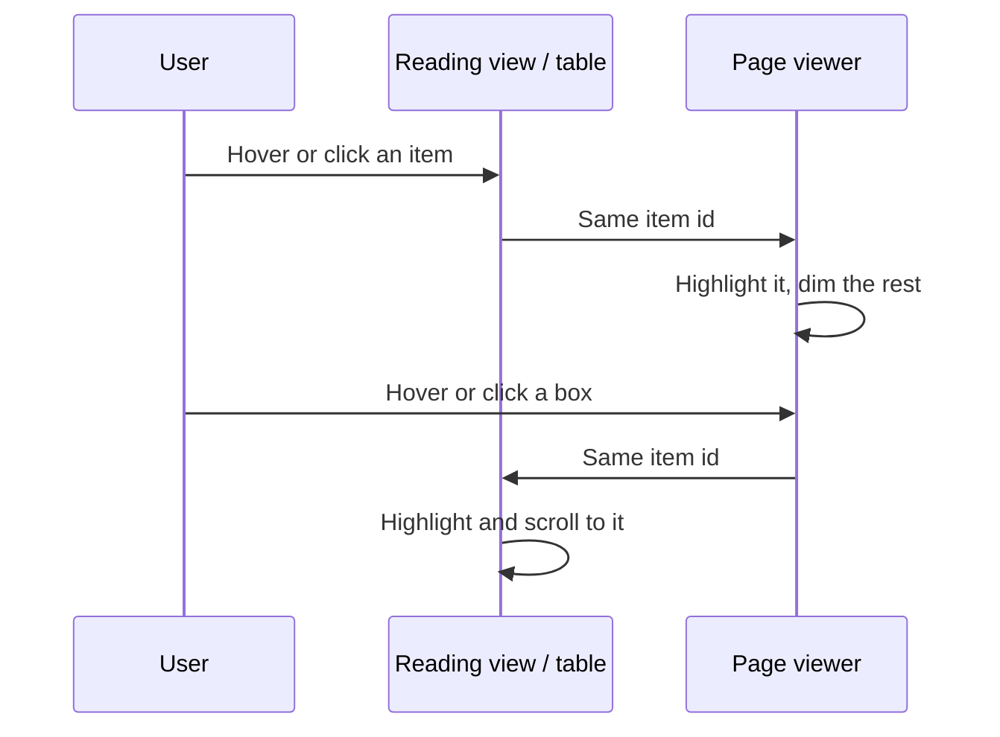

# Sky-DI

A mini **Document Intelligence Studio** built with Streamlit and Azure AI Document Intelligence. Pick a model,
give it a document, and see exactly what Azure read: the page with a box around every detected item, and a
portal-style reading view, tables, fields and raw JSON next to it.


## Features

- **Five models** from one dropdown, each with the tabs that suit it.
- **Interactive page viewer.** Hover a box to read it, click to select it, click again (or the page) to clear.
  Zoom 50 to 300%, and toggle each layer (paragraphs, lines, fields, tables, marks, barcodes) on or off.
- **Reading view.** The Content tab shows the text in reading order, like the Azure portal: titles and headings
  styled as such, page headers and footers marked, tables as real tables, checkboxes drawn as checkboxes.
- **Linked views.** Hovering or clicking in the reading view or a table lights up the same item on the page, and
  the other way round. Clicking a table row jumps to its page.
- **Compare mode.** Run two models on the same document side by side, with a summary table that highlights
  where the counts differ.
- **Selection marks and barcodes** (QR codes included) appear as their own tabs and boxes when the document has
  any.
- **Three ways in:** a bundled sample, an upload, or a public link.
- **Export.** CSV for every table tab, plain text for the reading view, and the raw JSON.
- **Fast reruns.** Results are cached per file and model, derived data is computed once, and each page image is
  sent to the browser once.

## Models

| Dropdown | Azure model | Tabs |
|---|---|---|
| OCR / Read | `prebuilt-read` | Content, Lines, JSON |
| Layout | `prebuilt-layout` | Content, Tables, Lines, JSON |
| Invoices | `prebuilt-invoice` | Fields, Tables, Content, Lines, JSON |
| Receipts | `prebuilt-receipt` | Fields, Tables, Content, Lines, JSON |
| General documents | `prebuilt-layout` with key-value pairs | Key-value pairs, Content, Tables, Lines, JSON |

"General documents" is `prebuilt-layout` with key-value pairs turned on, because Azure retired
`prebuilt-document` in API v4. The barcodes add-on is requested for every model. A **Marks** and a **Barcodes**
tab are added to the list above whenever the result has some.

## How it works



Compare mode runs the same flow once per model:



The page, the reading view and the tables stay in sync without calling Azure again:



## Getting started

You need Python 3.10 or newer and an Azure AI Document Intelligence resource (the free tier works).

```bash
git clone https://github.com/sherif2004/sky-di.git
cd sky-di
python -m venv .venv
source .venv/bin/activate        # Windows: .venv\Scripts\activate
pip install -r requirements.txt
cp .env.example .env             # Windows: copy .env.example .env
streamlit run app.py
```

Then put your endpoint and key in `.env`.

## Configuration

| Variable | Description |
|---|---|
| `AZURE_DOCINTEL_ENDPOINT` | Your resource endpoint, for example `https://<name>.cognitiveservices.azure.com/` |
| `AZURE_DOCINTEL_KEY` | A key for that resource |

Theme and Streamlit behaviour are in `.streamlit/config.toml`. The look is in `assets/` (`style.css`,
`motion.css`, `studio.css`).

## Documents

| Source | Details |
|---|---|
| Sample | An invoice (PDF), a receipt (PNG) and a layout form (PDF) are bundled in `samples/` |
| Upload | PDF, JPG, PNG, TIFF or BMP, up to 20 MB |
| Link | A public `http(s)` URL, up to 20 MB. Private, loopback and link-local addresses are refused, and so are redirects |

The free Azure tier allows about 20 calls a minute. On a `429` the app waits and retries a few times before
telling you to try again.

## Project structure

```
app.py              page layout, controls, selection state, tabs
skydi/analyzer.py   models, the Azure call with retry, and result -> rows for every kind of item
skydi/render.py     PDF and image -> page images, polygon scaling
skydi/viewer.py     page viewer component: boxes, tooltip, zoom, layer toggles
skydi/reader.py     reading view component: blocks in reading order, tables, checkboxes
skydi/hover.py      the hover link shared by the viewer and the reading view
skydi/ui.py         small HTML snippets (hero, model card, stats, comparison table)
assets/             styles, motion and favicon
samples/            bundled sample documents
Procfile            start command for Railway or any host that reads one
```

## Deploy

The `Procfile` works on Railway or any host that reads one. Set `AZURE_DOCINTEL_ENDPOINT` and
`AZURE_DOCINTEL_KEY` as environment variables.

## Notes

- `studio.css` hides Streamlit's menu, header, toolbar, footer and deploy button, so nothing on screen says
  Streamlit.
- Streamlit serves a blank page with its own title for a split second before the CSS loads. CSS can't change
  that moment.
